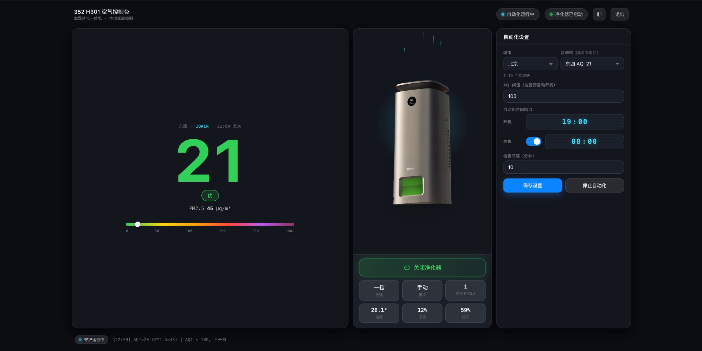

# 352 H301 空气净化器 · AQI 自动开关机与家庭控制台

对 **352 H301 加湿净化一体机**（352Life / 阿里云 IoT 平台）的云端控制逆向实现，
配合 **IQAir** 实时空气质量数据，实现「**晚间空气差自动开机、清晨自动关机**」的无人值守自动化，
并附带一个本地 Web 家庭控制台。

- **零依赖**：纯 Python 标准库（Python ≥ 3.10），无需 pip 安装任何包
- **凭据不落盘**：352Life 账号密码不写入任何程序文件 / 配置文件（详见 [凭据与安全](#凭据与安全)）
- **真机验证**：开关机、自动关机、会话自愈等链路均在真实设备上测试通过

```
北京时间 19:00 ~ 次日 08:00 窗口内:
  IQAir 监测站 AQI ≥ 阈值(默认100) 且设备未开机 → 自动开机
08:00 之后:
  设备开着 → 自动关机
其余时间: 只记录数据, 不动设备
```

## 界面预览



家庭控制台为**单屏三栏**布局：

- **左栏 · 空气质量** — 大字 AQI 与「优 / 良 / 轻度污染」等级标签、PM2.5 浓度、彩色浓度刻度条，数据来自 IQAir 指定监测站
- **中栏 · 设备控制** — 352 H301 实拍产品图（开机显示出风律动）、一键开关机、档位/模式与温湿度/室内 PM2.5/滤芯寿命实时读数
- **右栏 · 自动化设置** — 城市与监测站选择（联动刷新）、AQI 阈值、开机/关机时间窗（滚轮式选择器）、检查间隔

顶部状态胶囊实时显示「自动化运行中 / 净化器已启动」等状态，底部为守护日志流；深浅色主题随时间自动切换（19:00~07:00 深色）。

## 功能一览

| 模块 | 能力 |
|---|---|
| 设备控制 | 开机 / 关机 / 读状态（风速、模式、室内 PM2.5、温湿度、滤芯寿命） |
| AQI 数据 | IQAir 监测站实时 AQI / PM2.5，支持全国 42 个主要城市 + 城市内多站点枚举（中文站名） |
| 自动化 | 时间窗口精确到分钟（HH:MM，支持跨天），AQI 阈值触发开机，end_time 后自动关机 |
| Web 控制台 | 单屏三栏布局（空气质量 \| 设备控制 \| 自动化设置），深浅色随时间自动切换，登录门，开关等待态 |
| 无人值守 | CLI 单次执行入口 `purifier.py auto`，可接入 launchd / 定时任务 / 任意调度器 |

## 项目结构

```
purifier.py            主入口: CLI 命令 + AQI 拉取 + 自动化逻辑 (auto_once)
air352.py              352Life 云端 API 客户端 (登录链路 / 设备属性读写)
webui.py               本地 Web 控制台 (REST API + 静态页面, 默认 127.0.0.1:8765)
config.json            运行时配置 (首次运行自动生成, 已 gitignore)
config.example.json    配置模板
static/index.html      控制台前端 (单文件, 无构建)
static/product.png     产品图 (透明背景)
docs/screenshot.jpg    控制台界面截图
examples/              launchd 定时任务模板 (macOS)
```

## 快速开始

```bash
git clone https://github.com/Neptone/AirPurifier-352_Automation.git
cd AirPurifier-352_Automation

# 1) 准备凭据 (三选一, 见「凭据与安全」)
export AIR352_ACCOUNT="手机号"
export AIR352_PASSWORD="密码"
# 或: mkdir -p ~/.352life && 写入 credentials.json

# 2) 准备配置
cp config.example.json config.json

# 3) 试一下
python3 purifier.py stations              # 列出所在城市的 IQAir 监测站
python3 purifier.py status                # AQI + 设备状态 (只读)
python3 purifier.py auto                  # 执行一次自动化检查
python3 purifier.py on / off              # 手动开/关机

# 4) Web 控制台 (可选)
python3 webui.py 8765                     # http://127.0.0.1:8765

# 5) 无人值守 (可选, 任选一种调度方式)
python3 purifier.py auto --daemon         # 前台守护, 每 N 分钟检查
# 或 launchd / cron / 云端定时任务 调用: python3 purifier.py auto
```

### CLI 命令

| 命令 | 说明 |
|---|---|
| `status` | 局域网设备发现 + AQI + 设备状态（只读） |
| `on` / `off` | 开机 / 关机（带状态确认） |
| `auto` | **执行一次自动化检查**（供调度器调用的标准入口） |
| `auto --daemon` | 前台持续运行，每 `check_interval_min` 分钟检查一次 |
| `stations [省/市]` | 枚举 IQAir 监测站（slug、中文名、当前 AQI），如 `stations guangdong/guangzhou` |
| `discover` | 局域网 CoAP 发现 352 设备（调试用） |
| `config` | 交互式修改配置（凭据除外） |

## 配置说明（config.json）

| 字段 | 默认 | 说明 |
|---|---|---|
| `iqair_city_path` | `beijing/beijing` | IQAir 城市（省拼音/市拼音，可用 `stations` 命令查） |
| `iqair_station` | `daxing-huangcun` | 监测站 slug（站名会自动映射为中文） |
| `aqi_threshold` | `100` | 窗口内 AQI 达到该值即开机 |
| `start_time` | `19:00` | 自动化生效起始时间（HH:MM） |
| `end_time` | `08:00` | 生效结束时间，**过了该时间自动关机**；`null` = 不自动关 |
| `check_interval_min` | `10` | 守护模式检查间隔（分钟） |

时间窗口支持跨天（如 `19:00~08:00` 表示晚 7 点到次日早 8 点），也支持同日窗口（如 `08:00~17:00`）。

## 凭据与安全

**352Life 账号/密码不存放在任何程序文件、配置文件或仓库中。** 凭据按以下优先级读取：

1. 环境变量 `AIR352_ACCOUNT` / `AIR352_PASSWORD`
2. `~/.352life/credentials.json`（程序目录之外，建议 `chmod 600`；**删除该文件即撤销凭据**）
   ```json
   { "account": "手机号", "password": "密码" }
   ```
3. 交互终端运行时手动输入

Web 控制台登录的凭据仅保存在 webui 进程内存中，服务重启后需重新登录；
`/api/config` 等接口永不回传、永不接受账号密码字段。

> 无人值守（定时任务）运行必须有 1 或 2 的凭据来源，请自行权衡便利与风险。

## Web 控制台

`python3 webui.py [端口]` 启动（仅监听 127.0.0.1）。界面见 [界面预览](#界面预览)。

- 首次进入需登录 352Life 账号（凭据仅存内存）
- 三栏布局：左 AQI 大数字 + 色阶条；中设备控制（实拍产品图、开关等待态、指标网格）；右自动化设置
- 城市切换自动联动刷新监测站列表（带加载等待态）；监测站切换即时刷新 AQI（无需保存）
- 时间选择器：滚轮式 HH/MM 双列
- 深浅色主题随时间自动切换（19:00~07:00 深色）
- 「启动自动化」按钮为进程内守护（与外部调度器二选一即可，同时开也幂等无害）

REST API（供二次开发）：`/api/config`、`/api/cities`、`/api/location`、`/api/stations?city_path=`、
`/api/aqi?city_path=&station=`、`/api/status`、`/api/power`、`/api/login`、`/api/auto/once|start|stop|status`

## 技术要点（逆向链路）

### 352Life 云端控制（air352.py）

352 H301 接入阿里云 Link Platform，本地 UDP 11530 / CoAP 5683 通道被 ALCS 安全校验锁定
（需 accessKey/accessToken），因此走云端链路（参考开源项目 hass-air352，纯标准库重写）：

1. `app.352air.com/api/v1/enduser/login` — 352 账号登录（md5 签名头）→ access_token
2. `living/account/region/get` — 区域确认（阿里云 API 网关，HmacSHA1 x-ca 签名）
3. `api/prd/loginbyoauth.json` — OA 登录 → sid
4. `createSessionByAuthCode` — 换取 iotToken（约 20 小时有效）
5. `thing/properties/get|set` — 设备属性读写（电源为 `PowerSwitch`）

- token 失效（含服务端提前作废的 `29003 identityId is blank`）会抛 `Air352AuthError`，
  `relogin()` 强制重走全链路；上层 `_sess_call` 捕获后自动重登并重试一次（自愈）
- 请求自动 gzip 解压、错误码分类、超时控制

### AQI 数据源（purifier.py）

- 逆向 IQAir 网站的 React Router `.data` 端点（devalue 流式格式），**无需 API Key**
- 解析含 `_N` 引用解引用与 `P` deferred 值跳过
- 站点枚举：抓取 `/cn/` 中文城市页 HTML 表格，正则提取 slug/中文名/AQI
- 附带中国 HJ 633-2012 标准的 PM2.5 → AQI 换算（用于设备端 PM2.5 显示）

### 稳定性设计

- WebUI 进程内会话缓存（客户端 + iot_id）+ 线程锁，开关机响应 2s → 0.2s
- 鉴权失效自愈：缓存会话被服务端作废时自动重登重试，不再永久失效
- 前端 30s 请求超时（AbortController）+ 业务失败（`ok:false`）一律按错误处理
- 静态资源 `no-store`，避免改版后浏览器用旧缓存
- `/api/power` 失败返回 502（非 200），杜绝「假报成功」

## 已知限制

- 依赖 352Life 云端 API 与 IQAir 网页接口，**上游改版可能导致失效**（`stations`/`status` 可快速自检）
- IQAir 中国站点数据有约 1 小时粒度的更新延迟，适合场景判断而非实时预警
- 本仓库不提供局域网直控（ALCS 鉴权未破解，走云端中转）
- `webui.py` 仅监听本机回环地址；如需局域网访问请自行加认证与防火墙策略

## 致谢与声明

- 云端协议链路参考了开源项目 [hass-air352](https://github.com/imshosea/hass-air352)，本项目为纯标准库重写并增强了自愈/会话管理
- AQI 数据来自 [IQAir](https://www.iqair.com/)（网页接口逆向，仅个人学习使用，请勿商用/高频抓取）
- 产品图为网络实拍图抠图处理，权利归 352 品牌方所有，仅作界面示意
- 本项目仅供个人学习与家庭自动化使用，与 352 / 阿里云 / IQAir 无官方关系；请遵守当地法律法规与各平台服务条款

## License

MIT
